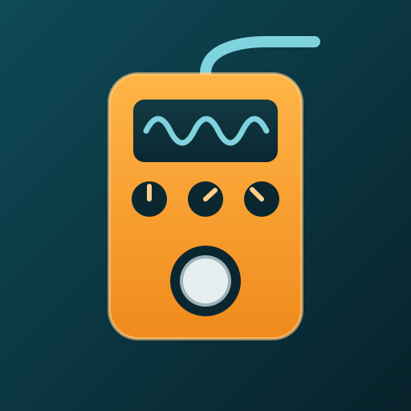

# 🎛️ PatchPilot

### Plug in your pedal. Say the sound you want. PatchPilot sets it up for you.

**37 pedals**: **30 Zoom** (MultiStomp, MultiStomp+, G/B FOUR, G1on, G3, G6, G11, B6…) **+ 7 Boss, Valeton, NUX and Line 6** — plus any MIDI pedal — on **Windows, macOS & Linux**, soon on **Android**

🌐 **Website:** https://francescorizzo-cyber.github.io/patchpilot/ · 🇮🇹 *[Italiano più sotto](#italiano)*

Multi-effects pedals are full of sounds, but getting the one you hear in your head means menus, tiny displays,
and knowing which of dozens of knobs to turn. **PatchPilot does that part for you.** You plug in the cable and
write what you want — *“warm blues crunch”*, *“less reverb, more presence for the solo”* — and PatchPilot
chooses the effects, sets the knobs **on your pedal** and tells you in one line what it did.

You don't need to know what a compressor is, which knob is which, or how your model's menus work.

> 📦 **Today's download is version 0.9.0.** Everything marked **🆕** comes with **0.9.1**, the next update (coming soon).
> 🧪 **Beta**: tested on a real **Zoom MS-50G**; the other models still wait for testers. [Got one? Help us in 5 minutes](TEST.md#english).

## ✨ How it works: three steps, no settings

| | | |
|:---:|---|---|
| **1** | 🔌 **Plug in** 🆕 | PatchPilot **recognises your pedal by itself** and connects as soon as you plug the cable in. On pedals that allow it, it reads **all your patches** and saves a **dated backup** before touching anything. No ports to choose, no boxes to tick. |
| **2** | 💬 **Ask for a sound** 🆕 | Press **“Ask for a sound”** and write it in your own words. The AI assistant builds it with your pedal's real effects and **PatchPilot sets it on the pedal**: effects, on/off and knobs. No list of knobs to turn by hand. Or load **20–30 seconds of a song** (or record it with the microphone): PatchPilot measures distortion, tone, delay, reverb and modulation and builds a patch close to it. |
| **3** | 🎯 **Fine-tune by talking** 🆕 | *“Too muddy.”* *“Like before, but less distorted.”* *“You do it.”* The **sound coach** changes only what is needed and explains it in one line. **Every step is saved as a variant**: one click takes you back to any earlier step, or to how it was at the start. |

Then you play: **setlist, stage mode and songs that follow the tempo** tell you which sound comes next.

### 🛡️ Your saved sounds are never overwritten

- PatchPilot works on the **patch in use**, exactly as when you turn the pedal's own knobs: it **never saves over your patches**.
  Like the sound? Save it on the pedal, or keep it as a variant on the computer. Don't like it? Change patch and everything is back as it was.
- Before the first change, on pedals that allow it, it saves a **backup of all your patches** with date and time (never overwritten).
- **Factory reset and deleting files in the pedal are blocked forever** in the code. Saving to the pedal's memory and sending whole patches stay blocked until a model has been tested.

## 🎸 Everything it does

**Sound, without the manual**
- 💬 **Ask for a sound** 🆕 — describe it, PatchPilot builds it on the pedal. It can also add effects the patch doesn't have yet (old MultiStomp family).
- 🎯 **Sound coach** 🆕 — keep talking, it changes 1–3 things at a time, every step can be undone.
- 🎵 **Sound from a song** 🆕 — 20–30 s from a file or the microphone; measured on your computer, the audio never leaves it.
- 🎓 **The teacher** 🆕 — *“Explain this patch”*: what each effect and knob does, how they work together, a small experiment to try.
- 🎛️ **Knobs turned by PatchPilot** 🆕 — move a knob in the editor and it moves on the pedal.
- 💾 **Variants** 🆕 — *“clean verse”*, *“solo with more gain”*: several versions of the same patch, on your computer.

**Look inside your pedal**
- 🔌 Automatic recognition and connection 🆕 · 📋 full patch list with names · 🎛️ effects and parameters editor (knobs or faders) with the real names · 🎸 big needle tuner · 🖼️ a main screen drawn like **your** model.

**Keep your sounds safe and tidy**
- 💾 Backup of every patch (automatic and dated 🆕) · 📄 printable **sound sheets** · 🔎 *“where did I use that delay?”* search · ⚖️ compare two patches.

**On stage**
- 🎶 **Setlist** with a patch per song, one per pedal if you use several · ⏭️ song bar: mouse wheel, arrows, space bar or a USB/Bluetooth page-turner pedal
- 🌙 **Stage mode**: dark screen, big letters, what to play now and what comes next
- 🥁 **Songs that follow the tempo**: sections with their bars, count-in and a **“GET READY: 1-03 Crunch”** warning before every change; delay times for the song's tempo
- 🌊 **Gradual transitions**: the sound changes little by little, like a virtual expression pedal

**Volume**
- 🔊 **Every patch at the same volume**: play the same riff with each patch, PatchPilot measures loudness as the ear hears it (LUFS) and tells you the level to set · 📈 audio level meter · 🎚️ MIDI faders

**Community**
- 📚 **[Patch library](https://francescorizzo-cyber.github.io/patchpilot/libreria/)**: patches shared by users, free (CC0), searchable by song, artist, genre and pedal; share yours with one click
- 🙋 **Tester page**: your pedal is not listed? A guided, listen-only recording helps us add it
- 🌍 **10 languages** 🆕: English, Italiano, Français, Español, Deutsch, Português, Svenska, Dansk, Slovenščina, Hrvatski

## 🎚️ Supported pedals: 37 + any MIDI pedal

| Pedals | Recognised by itself | Reads the patches | PatchPilot sets the sound | Status |
|---|:---:|:---:|:---:|---|
| **Zoom MS-50G** | ✅ | ✅ all 50 + backup | ✅ in one go, effects included | ✅ **tested on a real pedal** |
| **Zoom MS-60B · MS-70CDR · G1on · G1Xon · B1on · B1Xon · G3 · G3X · B3** 🆕 | ✅ | ✅ + backup | ✅ in one go, effects included | 🧪 in test |
| **Zoom MS-50G+ · MS-60B+ · MS-70CDR+ · MS-80IR+ · MS-200D+ · MS-90LP+** | ✅ | ✅ + tuner | ✅ 🆕 one change at a time | 🧪 in test |
| **Zoom G2 FOUR · G2X FOUR · B2 FOUR** | ✅ | ✅ + tuner | ✅ 🆕 one change at a time | 🧪 in test |
| **Zoom G1 FOUR · G1X FOUR · B1 FOUR · B1X FOUR · G3n · G3Xn · G5n · B3n** | ✅ | ✅ | ✅ 🆕 one change at a time | 🧪 in test |
| **Zoom G6 · G11 · B6** | choose it once | ✅ | ✅ 🆕 one change at a time | 🧪 not yet tried on a real pedal |
| **Boss Katana MkII · GT-100 · GT-1000 / GT-1000CORE · Valeton GP-200** 🆕 | ✅ | ✅ patch in use | ✅ one change at a time | 🧪 in test |
| **Boss Katana MkI · NUX Mighty Lite BT MkII** 🆕 | choose it once | ✅ patch in use | ✅ one change at a time | 🧪 in test |
| **Line 6 HX Stomp** 🆕 · **any MIDI pedal, any brand** | – | – | patch change for every song of the setlist, MIDI controls | standard MIDI |

On models still *in test* everything works as on the MS-50G, with a **“Model in testing”** notice and a **“Send the log…”** button:
one click and you help us confirm your model.

### 🙋 Your pedal is not in the list? Become a tester

The computer program has a **Tester** page: a guided recording that only **listens**. It sends your pedal nothing but
the standard MIDI identity request, then records what the pedal sends while you change patch and turn a knob.
Save the file and send it to **[autofonic.mixer@gmail.com](mailto:autofonic.mixer@gmail.com)** with brand and model.

## ⬇️ Install

### 💻 Windows, macOS, Linux

From **[Releases](../../releases/latest)**, Java included:

- **Windows 10/11**: `PatchPilot-x.y.z-windows-x64-setup.exe` (installer) or `…-portatile.zip` (no install). If SmartScreen warns you: **More info → Run anyway**.
- **macOS**: `…-macos-arm64.dmg` (Apple Silicon M1–M4) or `…-macos-x64.dmg` (Intel). Drag PatchPilot into Applications; the first time **System Settings → Privacy & Security → Open Anyway**. *Mac testers wanted.*
- **Linux**: `…-linux-x64.deb` (`sudo apt install ./PatchPilot-….deb`) or `…-linux-x64.tar.gz` (run `PatchPilot/bin/PatchPilot`).

Then **plug the pedal in with its USB cable**: that's it. *(Close Guitar Lab or other editors first: the pedal talks to one program at a time.)*

### 📱 Android

Coming soon, **only on Google Play** (the link will appear here). Android 8.0 or later with USB host (OTG) and a USB-C/OTG cable.

- 🔌 **Just plug it in**: the pedal is recognized by itself, no buttons and no MIDI settings.
- 💬 **AI sound coach**: type "more distortion" or "80s delay", the AI turns the knobs, switches effects on and adds the missing ones, then tells you in one line what it did. Every step can be undone.
- 🎵 **Tone from a song**: play 20–30 seconds, the phone measures the sound and the AI builds the patch. Audio never leaves the phone.
- 👆 The drawing of your pedal: **swipe** left/right to change model, up/down to change song.
- 🎼 Patch reading and editor, variations, patch explained for beginners, tuner, setlist and stage mode, backup.
- 🔑 **Same prices as on the computer** (see below), bought inside the app with Google Play.

## 🔑 Full version: €6.99, one time only

**7 days with everything on**, AI assistant included (up to 50 requests a day). After that, what you need to use
your pedal **stays free forever**: recognition, patch reading, editor, knobs from the computer, tuner, backup inside the program, 3-song setlist.

| | Free forever | Full version |
|---|:---:|:---:|
| Recognition, patch list, editor, knobs from the computer, tuner | ✅ | ✅ |
| Backup inside the program, log, Tester page, patch library | ✅ | ✅ |
| Setlist | 3 songs | unlimited + stage mode |
| Backup export and sound sheets, search, compare | — | ✅ |
| Variants | — | ✅ |
| AI: ask for a sound, coach, sound from a song, teacher | 5-day trial, up to 50 a day | ✅ 25 requests a day for 12 months |

1. In PatchPilot open the **Support ♥** page and copy your device code (`PP-ABCD-EFGH`).
2. Pay **€6.99**:
   - **[💳 Card, Google Pay or Apple Pay (Stripe)](https://buy.stripe.com/7sYeVc6Yb71O9pu3vP63K03)** — paste the device code: the **unlock code appears right after the payment**.
   - **[🅿️ PayPal](https://paypal.me/AutoFonicMixer/6.99EUR)** — then write to **[autofonic.mixer@gmail.com](mailto:autofonic.mixer@gmail.com)**: the unlock code arrives by email, usually within a day.

One code per computer. On Android the full version is bought inside the app, with Google Play.
Just want to say thanks? **[paypal.me/AutoFonicMixer](https://paypal.me/AutoFonicMixer)**.

### 💬 What to say to the coach: examples

Write the way you'd talk to a guitarist friend: no knob or effect names needed.

- **To start, “Ask for a sound”:** *“70s crunch like AC/DC”* · *“bright clean for arpeggios”* · *“warm lead with a long delay”* · *“tight metal distortion, no hiss”* · *“ambient sound with a huge reverb”* · *“SRV-style blues”*
- **To fine-tune:** *“too muddy”* · *“more aggressive”* · *“less distorted”* · *“more bass”* · *“cut through the mix more”* · *“like before but cleaner”* · *“you do it”*
- **On the effects:** *“add a light chorus”* · *“remove the delay”* · *“shorter reverb”* · *“80s tempo delay”* · *“switch on a compressor”*
- **If you don't like it:** *“go back”* · *“start over”* · *“explain what you changed”*

The coach uses only your pedal's effects and changes 1–3 things at a time. Every message is one request.

### 📴 Coach without AI: 10 languages, offline, free

In the Android app the coach also works **without AI**: it understands more than 60 kinds of commands directly on the phone, with no internet and no requests used. It stays **free forever**, also after the trial. Write in your own language: it understands
🇮🇹 Italiano · 🇬🇧 English · 🇪🇸 Español · 🇫🇷 Français · 🇩🇪 Deutsch · 🇵🇹 Português · 🇸🇪 Svenska · 🇩🇰 Dansk · 🇸🇮 Slovenščina · 🇭🇷 Hrvatski
and answers in the language of the app.

What it can do:
- **Tone and gain:** warmer, brighter, more/less bass or mids, more distorted, cleaner, louder, quieter
- **Delay:** more/less, longer/shorter, more repeats, in time with the song (*delay at 120 bpm, dotted eighths*), in ms, slapback
- **Reverb, modulation, dynamics:** more/less reverb, longer tail, faster chorus, more compression, less noise, more wah
- **Effects by name:** turn on/off, add one (*add a phaser*), swap one (*replace the chorus with a flanger*), factory settings
- **Knobs by name:** *delay mix to 30%*, *Time 450 ms*, *gain to maximum*, *turn up the reverb mix*
- **19 styles:** metal, rock, blues, jazz, funky, country, punk, pop, reggae, dub, doom, post-rock, ambient, '80s, surf, grunge, lead, rhythm, acoustic
- **Conversation:** *again*, *too much*, *a bit…*, *much…*; several commands in one sentence
- **Tone from a song** without AI: the measured sound becomes settings right on the phone

Examples, also complex:

| | |
|---|---|
| 🇬🇧 | *much warmer, less reverb and turn off the chorus* · *replace the chorus with a phaser and delay at 100 bpm dotted eighths* |
| 🇮🇹 | *più caldo, meno riverbero e delay a 120 bpm ottavi puntati* · *Mix del delay al 30%, Time 450 ms e spegni TS Drive* |
| 🇪🇸 | *más distorsionado pero con menos graves y un poco más de delay* · *apaga el chorus, sube el mix del delay y más graves* |
| 🇫🇷 | *plus chaud, moins de reverb et delay à 120 bpm* · *beaucoup plus de gain mais moins de graves* |
| 🇩🇪 | *viel wärmer, weniger Hall und Chorus aus* · *ersetze den Chorus durch einen Flanger und mehr Wiederholungen* |
| 🇵🇹 | *mais quente, menos reverb e desliga o chorus* |
| 🇸🇪 | *varmare, mer reverb och längre delay* |
| 🇩🇰 | *varmere og mere rumklang, sluk delay* |
| 🇸🇮 | *toplejše in manj odmeva, izklopi chorus* |
| 🇭🇷 | *toplije i više jeke, isključi chorus* |

Free sentences like *"Gilmour's solo sound"* are a job for the AI coach. The **📋 Commands** button in the app lists them all, translated: one tap sends them.

### 🤖 AI assistant: free and paid requests

Every message to the assistant is one request: "Ask for a sound", every coach step, "Tone from a song", "Explain this patch". The rest of PatchPilot uses no requests.

| | Requests | Price |
|---|---|---|
| **Trial** (no code) | up to 50 a day for 7 days | free |
| **Full version** | 25 a day for 12 months from first use | included in €6.99 |
| **AI renewal** after 12 months | 25 a day for another 12 months | [€2.99](https://buy.stripe.com/eVq9ASdmz85SdFKd6p63K04) |
| **100 extra requests** | never expire; used automatically when the day's requests or the included months run out | €1.99, as often as you like |

The 100 requests work with the unlocked full version. On computers: **[💳 buy 100 requests by card (€1.99)](https://buy.stripe.com/00w9AS1DRdqc6di5DX63K02)** typing your device code, or use the button on the **Support ♥** page; they show up by themselves at your next request. Paid with PayPal? Write to us with your device code: you get an **AI code** to type on the **Support ♥** page. On Android they are bought inside the app with Google Play. When the AI is no longer active, the rest of PatchPilot stays yours forever.

## 📄 Privacy & license

No account, no ads, no analytics. The AI functions send only your request and the patch values (numbers) to the service — **never audio**:
songs and microphone are measured on your device. Everything else works offline. [Privacy policy](https://francescorizzo-cyber.github.io/patchpilot/privacy.html) · [License](LICENSE).

PatchPilot is an independent project, **not affiliated with, endorsed or sponsored by Zoom Corporation, Boss/Roland, Valeton, NUX or Line 6**.
Brand and model names are trademarks of their owners, mentioned only to describe compatibility.

---

# 🇮🇹 Italiano

### Collega il pedale. Di' che suono vuoi. Al resto pensa PatchPilot.

**37 pedali**: **30 Zoom** (MultiStomp, MultiStomp+, G/B FOUR, G1on, G3, G6, G11, B6…) **+ 7 Boss, Valeton, NUX e Line 6** — più qualsiasi pedale MIDI — su **Windows, macOS e Linux**, presto su **Android**

🌐 **Sito:** https://francescorizzo-cyber.github.io/patchpilot/it/

I multieffetto a pedale sono pieni di suoni, ma arrivare a quello che hai in testa vuol dire menu, display minuscoli
e sapere quale manopola girare tra decine. **Quella parte la fa PatchPilot.** Attacchi il cavo e scrivi cosa vuoi —
*«crunch blues caldo»*, *«meno riverbero, più presenza nell'assolo»* — e PatchPilot sceglie gli effetti,
imposta le manopole **sul tuo pedale** e ti dice in una riga cosa ha fatto.

Non serve sapere cos'è un compressore, quale manopola è quale o come funzionano i menu del tuo modello.

> 📦 **Il download di oggi è la versione 0.9.0.** Tutto quello che è segnato **🆕** arriva con la **0.9.1**, il prossimo aggiornamento (in arrivo).
> 🧪 **Beta**: provata su uno **Zoom MS-50G** vero; gli altri modelli aspettano i tester. [Ne hai uno? Aiutaci in 5 minuti](TEST.md#italiano).

## ✨ Come funziona: tre passi, nessuna impostazione

| | | |
|:---:|---|---|
| **1** | 🔌 **Collega** 🆕 | PatchPilot **riconosce il pedale da solo** e si collega appena attacchi il cavo. Sui pedali che lo permettono legge **tutte le tue patch** e salva un **backup con data e ora** prima di toccare qualsiasi cosa. Niente porte da scegliere, niente caselle da spuntare. |
| **2** | 💬 **Chiedi un suono** 🆕 | Premi **«Chiedi un suono»** e scrivilo con parole tue. L'assistente AI lo costruisce con gli effetti veri del tuo pedale e **PatchPilot lo imposta sul pedale**: effetti, acceso/spento e manopole. Nessun elenco di manopole da girare a mano. Oppure carica **20–30 secondi di una canzone** (o falla sentire al microfono): PatchPilot misura distorsione, timbro, delay, riverbero e modulazione e costruisce una patch che ci somiglia. |
| **3** | 🎯 **Rifinisci parlando** 🆕 | *«Troppo impastato.»* *«Come prima ma meno distorto.»* *«Fallo tu.»* Il **coach del suono** cambia solo quello che serve e lo spiega in una riga. **Ogni passo resta salvato come variante**: con un clic torni a qualsiasi passo precedente, o a com'era all'inizio. |

Poi suoni: **scaletta, modalità palco e brani che seguono il tempo** ti dicono qual è il suono successivo.

### 🛡️ I suoni che hai salvato non vengono mai sovrascritti

- PatchPilot lavora sulla **patch in uso**, proprio come quando giri le manopole del pedale: **non salva mai sopra le tue patch**.
  Il suono ti piace? Lo salvi sul pedale, oppure lo tieni come variante sul computer. Non ti piace? Cambi patch e torna tutto com'era.
- Prima della prima modifica, sui pedali che lo permettono, salva un **backup di tutte le patch** con data e ora (mai sovrascritto).
- **Ripristino di fabbrica e cancellazione di file nel pedale sono vietati per sempre** nel codice. Il salvataggio nella memoria del pedale e l'invio di patch intere restano bloccati finché un modello non è stato provato.

## 🎸 Tutto quello che fa

**Il suono, senza il manuale**
- 💬 **Chiedi un suono** 🆕 — lo descrivi, PatchPilot lo costruisce sul pedale. Può anche aggiungere effetti che la patch non ha ancora (famiglia dei vecchi MultiStomp).
- 🎯 **Coach del suono** 🆕 — continui a parlare, cambia 1–3 cose alla volta, ogni passo si può annullare.
- 🎵 **Suono preso da un brano** 🆕 — 20–30 s da file o dal microfono; misurato sul tuo computer, l'audio non esce mai.
- 🎓 **Il maestro** 🆕 — *«Spiegami questa patch»*: a cosa serve ogni effetto e ogni manopola, come lavorano insieme, un piccolo esperimento da provare.
- 🎛️ **Manopole girate da PatchPilot** 🆕 — muovi una manopola nell'editor e si muove sul pedale.
- 💾 **Varianti** 🆕 — *«strofa pulita»*, *«assolo con più gain»*: più versioni della stessa patch, sul tuo computer.

**Guarda dentro il pedale**
- 🔌 Riconoscimento e collegamento automatici 🆕 · 📋 elenco di tutte le patch con i nomi · 🎛️ editor di effetti e parametri (manopole o fader) con i nomi veri · 🎸 accordatore a lancetta, grande · 🖼️ schermata principale disegnata come il **tuo** modello.

**Suoni al sicuro e in ordine**
- 💾 Backup di tutte le patch (automatico e con data 🆕) · 📄 **schede suono** da stampare · 🔎 ricerca *«dove ho usato quel delay?»* · ⚖️ confronto tra due patch.

**Sul palco**
- 🎶 **Scaletta** con una patch per brano, una per pedale se ne usi più di uno · ⏭️ barra dei brani: rotella del mouse, frecce, barra spaziatrice o pedale volta-pagina USB/Bluetooth
- 🌙 **Modalità palco**: schermo scuro, caratteri grandi, cosa suonare adesso e cosa viene dopo
- 🥁 **Brani che seguono il tempo**: sezioni con le loro battute, conteggio iniziale e avviso **«PREPARA: 1-03 Crunch»** prima di ogni cambio; tempi del delay per il tempo del brano
- 🌊 **Passaggi graduali**: il suono cambia piano piano, come con un pedale d'espressione virtuale

**Volume**
- 🔊 **Tutte le patch allo stesso volume**: suoni lo stesso giro con ogni patch, PatchPilot misura il volume come lo sente l'orecchio (LUFS) e ti dice il livello da impostare · 📈 misuratore del livello audio · 🎚️ fader MIDI

**Comunità**
- 📚 **[Libreria di patch](https://francescorizzo-cyber.github.io/patchpilot/it/libreria/)**: patch condivise da chi usa PatchPilot, libere (CC0), da cercare per brano, artista, genere e pedale; condividi la tua con un clic
- 🙋 **Pagina Tester**: il tuo pedale non c'è? Una registrazione guidata che ascolta soltanto ci aiuta ad aggiungerlo
- 🌍 **10 lingue** 🆕: italiano, English, Français, Español, Deutsch, Português, Svenska, Dansk, Slovenščina, Hrvatski

## 🎚️ Pedali supportati: 37 + qualsiasi pedale MIDI

| Pedali | Riconosciuto da solo | Legge le patch | PatchPilot imposta il suono | Stato |
|---|:---:|:---:|:---:|---|
| **Zoom MS-50G** | ✅ | ✅ tutte le 50 + backup | ✅ in un colpo solo, effetti compresi | ✅ **provato su un pedale vero** |
| **Zoom MS-60B · MS-70CDR · G1on · G1Xon · B1on · B1Xon · G3 · G3X · B3** 🆕 | ✅ | ✅ + backup | ✅ in un colpo solo, effetti compresi | 🧪 in prova |
| **Zoom MS-50G+ · MS-60B+ · MS-70CDR+ · MS-80IR+ · MS-200D+ · MS-90LP+** | ✅ | ✅ + accordatore | ✅ 🆕 una modifica alla volta | 🧪 in prova |
| **Zoom G2 FOUR · G2X FOUR · B2 FOUR** | ✅ | ✅ + accordatore | ✅ 🆕 una modifica alla volta | 🧪 in prova |
| **Zoom G1 FOUR · G1X FOUR · B1 FOUR · B1X FOUR · G3n · G3Xn · G5n · B3n** | ✅ | ✅ | ✅ 🆕 una modifica alla volta | 🧪 in prova |
| **Zoom G6 · G11 · B6** | lo scegli una volta | ✅ | ✅ 🆕 una modifica alla volta | 🧪 non ancora provati su un pedale vero |
| **Boss Katana MkII · GT-100 · GT-1000 / GT-1000CORE · Valeton GP-200** 🆕 | ✅ | ✅ patch in uso | ✅ una modifica alla volta | 🧪 in prova |
| **Boss Katana MkI · NUX Mighty Lite BT MkII** 🆕 | lo scegli una volta | ✅ patch in uso | ✅ una modifica alla volta | 🧪 in prova |
| **Line 6 HX Stomp** 🆕 · **qualsiasi pedale MIDI, di qualsiasi marca** | – | – | cambio patch per ogni brano della scaletta, comandi MIDI | MIDI standard |

Sui modelli ancora *in prova* funziona tutto come sull'MS-50G, con l'avviso **«Modello in prova»** e il pulsante **«Manda il registro…»**:
un clic e ci aiuti a confermare il tuo modello.

### 🙋 Il tuo pedale non è in elenco? Diventa tester

Il programma per computer ha la pagina **Tester**: una registrazione guidata che **ascolta soltanto**. Al pedale manda
solo la richiesta di identità MIDI standard, poi registra quello che il pedale invia mentre cambi patch e giri una manopola.
Salva il file e mandalo ad **[autofonic.mixer@gmail.com](mailto:autofonic.mixer@gmail.com)** con marca e modello.

## ⬇️ Installazione

### 💻 Windows, macOS, Linux

Da **[Releases](../../releases/latest)**, con Java incluso:

- **Windows 10/11**: `PatchPilot-x.y.z-windows-x64-setup.exe` (installatore) oppure `…-portatile.zip` (senza installazione). Se SmartScreen avvisa: **Ulteriori informazioni → Esegui comunque**.
- **macOS**: `…-macos-arm64.dmg` (Apple Silicon M1–M4) oppure `…-macos-x64.dmg` (Intel). Trascina PatchPilot in Applicazioni; la prima volta **Impostazioni di Sistema → Privacy e sicurezza → Apri comunque**. *Cerchiamo tester con il Mac.*
- **Linux**: `…-linux-x64.deb` (`sudo apt install ./PatchPilot-….deb`) oppure `…-linux-x64.tar.gz` (avvia `PatchPilot/bin/PatchPilot`).

Poi **collega il pedale con il suo cavo USB**: fatto. *(Chiudi prima Guitar Lab o altri editor: il pedale parla con un programma alla volta.)*

### 📱 Android

In arrivo, **solo su Google Play** (il link comparirà qui). Android 8.0 o successivo con USB host (OTG) e un cavo USB-C/OTG.

- 🔌 **Collega e basta**: il pedale viene riconosciuto da solo, niente pulsanti e niente impostazioni MIDI.
- 💬 **Coach del suono con l'AI**: scrivi «più distorto» o «delay anni '80», l'AI gira le manopole, accende gli effetti e aggiunge quelli che mancano, poi ti dice in una riga cosa ha fatto. Ogni passo si annulla.
- 🎵 **Suono preso da un brano**: fai ascoltare 20–30 secondi, il telefono misura il suono e l'AI costruisce la patch. L'audio non esce dal telefono.
- 👆 Il disegno del tuo pedale: **scorri** a sinistra/destra per cambiare modello, su/giù per cambiare brano.
- 🎼 Lettura ed editor delle patch, varianti, spiegazione della patch per chi comincia, accordatore, scaletta e modalità palco, backup.
- 🔑 **Stessi prezzi del computer** (vedi sotto), comprati dentro l'app con Google Play.

## 🔑 Versione completa: 6,99 €, una volta sola

**7 giorni con tutto acceso**, assistente AI compreso (fino a 50 richieste al giorno). Poi quello che serve per usare
il pedale **resta gratis per sempre**: riconoscimento, lettura delle patch, editor, manopole dal computer, accordatore, backup nel programma, scaletta di 3 brani.

| | Gratis per sempre | Versione completa |
|---|:---:|:---:|
| Riconoscimento, elenco patch, editor, manopole dal computer, accordatore | ✅ | ✅ |
| Backup nel programma, registro, pagina Tester, libreria di patch | ✅ | ✅ |
| Scaletta | 3 brani | senza limiti + modalità palco |
| Esportazione del backup e schede suono, ricerca, confronto | — | ✅ |
| Varianti | — | ✅ |
| AI: chiedi un suono, coach, suono da un brano, maestro | 7 giorni di prova, fino a 50 al giorno | ✅ 25 richieste al giorno per 12 mesi |

1. In PatchPilot apri la pagina **Sostieni ♥** e copia il codice dispositivo (`PP-ABCD-EFGH`).
2. Paga **6,99 €**:
   - **[💳 Carta, Google Pay o Apple Pay (Stripe)](https://buy.stripe.com/7sYeVc6Yb71O9pu3vP63K03)** — incolla il codice dispositivo: il **codice di sblocco appare subito dopo il pagamento**.
   - **[🅿️ PayPal](https://paypal.me/AutoFonicMixer/6.99EUR)** — poi scrivi ad **[autofonic.mixer@gmail.com](mailto:autofonic.mixer@gmail.com)**: il codice di sblocco arriva per email, di solito entro un giorno.

Un codice per ogni computer. Su Android la versione completa si compra dentro l'app, con Google Play.
Vuoi solo dire grazie? **[paypal.me/AutoFonicMixer](https://paypal.me/AutoFonicMixer)**.

### 💬 Cosa dire al coach: esempi

Scrivi come parleresti a un amico chitarrista: non servono nomi di manopole né di effetti.

- **Per partire, «Dimmi il suono»:** *«crunch anni '70 alla AC/DC»* · *«pulito brillante per arpeggi»* · *«lead caldo con delay lungo»* · *«distorsione metal stretta, senza fruscio»* · *«suono ambient con riverbero enorme»* · *«blues alla SRV»*
- **Per rifinire:** *«troppo impastato»* · *«più aggressivo»* · *«meno distorto»* · *«più bassi»* · *«più presente nel mix»* · *«come prima ma più pulito»* · *«fallo tu»*
- **Sugli effetti:** *«aggiungi un chorus leggero»* · *«togli il delay»* · *«riverbero più corto»* · *«delay a tempo, anni '80»* · *«accendi un compressore»*
- **Se non ti piace:** *«torna indietro»* · *«rifallo da capo»* · *«spiegami cosa hai cambiato»*

Il coach usa solo gli effetti del tuo pedale e cambia 1–3 cose alla volta. Ogni frase è una richiesta.

### 📴 Coach senza AI: 10 lingue, senza internet, gratis

Nell'app Android il coach funziona anche **senza AI**: capisce oltre 60 tipi di comandi direttamente sul telefono, senza internet e senza consumare richieste. Resta **gratis per sempre**, anche dopo la prova. Scrivi nella tua lingua: capisce
🇮🇹 Italiano · 🇬🇧 English · 🇪🇸 Español · 🇫🇷 Français · 🇩🇪 Deutsch · 🇵🇹 Português · 🇸🇪 Svenska · 🇩🇰 Dansk · 🇸🇮 Slovenščina · 🇭🇷 Hrvatski
e risponde nella lingua dell'app.

Cosa sa fare:
- **Timbro e gain:** più caldo, più brillante, più o meno bassi e medi, più distorto, più pulito, più o meno volume
- **Delay:** più o meno, più lungo o più corto, più ripetizioni, a tempo con il brano (*delay a 120 bpm ottavi puntati*), in ms, slapback
- **Riverbero, modulazione, dinamica:** più o meno riverbero, coda più lunga, chorus più veloce, più compressione, meno fruscio, più wah
- **Effetti per nome:** accendi e spegni, aggiungi (*aggiungi un phaser*), sostituisci (*sostituisci il chorus con un flanger*), valori di fabbrica
- **Manopole per nome:** *Mix del delay al 30%*, *Time 450 ms*, *Gain al massimo*, *alza il Mix del riverbero*
- **19 stili:** metal, rock, blues, jazz, funky, country, punk, pop, reggae, dub, doom, post-rock, ambient, anni '80, surf, grunge, assolo, ritmica, acustico
- **Conversazione:** *ancora*, *troppo*, *un po'…*, *molto…*; più comandi nella stessa frase
- **Suono da un brano** senza AI: il suono misurato diventa impostazioni direttamente sul telefono

Esempi, anche complessi:

| | |
|---|---|
| 🇮🇹 | *più caldo, meno riverbero e delay a 120 bpm ottavi puntati* · *sostituisci il chorus con un phaser e alza il Mix del delay* · *Mix del delay al 30%, Time 450 ms e spegni TS Drive* · *molto più distorto e un po' più di riverbero* |
| 🇬🇧 | *much warmer, less reverb and turn off the chorus* · *replace the chorus with a phaser and delay at 100 bpm dotted eighths* |
| 🇪🇸 | *más distorsionado pero con menos graves y un poco más de delay* · *apaga el chorus, sube el mix del delay y más graves* |
| 🇫🇷 | *plus chaud, moins de reverb et delay à 120 bpm* · *beaucoup plus de gain mais moins de graves* |
| 🇩🇪 | *viel wärmer, weniger Hall und Chorus aus* · *ersetze den Chorus durch einen Flanger und mehr Wiederholungen* |
| 🇵🇹 | *mais quente, menos reverb e desliga o chorus* |
| 🇸🇪 | *varmare, mer reverb och längre delay* |
| 🇩🇰 | *varmere og mere rumklang, sluk delay* |
| 🇸🇮 | *toplejše in manj odmeva, izklopi chorus* |
| 🇭🇷 | *toplije i više jeke, isključi chorus* |

Le frasi libere come *«il suono dell'assolo di Gilmour»* restano un lavoro per il coach con l'AI. Nell'app il pulsante **📋 Comandi** li elenca tutti, tradotti: un tocco e partono.

### 🤖 Assistente AI: richieste gratis e a pagamento

Ogni messaggio all'assistente è una richiesta: «Chiedi un suono», ogni passo del coach, «Suono preso da un brano», «Spiegami questa patch». Tutto il resto di PatchPilot non usa richieste.

| | Richieste | Prezzo |
|---|---|---|
| **Prova** (senza codice) | fino a 50 al giorno per 7 giorni | gratis |
| **Versione completa** | 25 al giorno per 12 mesi dal primo uso | inclusa nei 6,99 € |
| **Rinnovo AI** dopo i 12 mesi | 25 al giorno per altri 12 mesi | [2,99 €](https://buy.stripe.com/eVq9ASdmz85SdFKd6p63K04) |
| **100 richieste in più** | non scadono mai; si usano da sole quando finiscono quelle del giorno o i mesi inclusi | 1,99 €, quante volte vuoi |

Le 100 richieste valgono con la versione completa sbloccata. Sul computer: **[💳 compra 100 richieste con la carta (1,99 €)](https://buy.stripe.com/00w9AS1DRdqc6di5DX63K02)** scrivendo il codice dispositivo, oppure dal pulsante nella pagina **Sostieni ♥**; compaiono da sole alla richiesta successiva. Paghi con PayPal? Scrivici con il codice dispositivo: ricevi un **codice AI** da scrivere nella pagina **Sostieni ♥**. Su Android si comprano dentro l'app con Google Play. Quando l'AI non è più attiva, il resto di PatchPilot resta tuo per sempre.

## 📄 Privacy e licenza

Nessun account, nessuna pubblicità, nessuno strumento di analisi. Le funzioni AI mandano al servizio solo la tua richiesta e i valori della patch (numeri) — **mai l'audio**:
canzoni e microfono vengono misurati sul tuo dispositivo. Tutto il resto funziona senza internet. [Informativa privacy](https://francescorizzo-cyber.github.io/patchpilot/privacy.html) · [Licenza](LICENSE).

PatchPilot è un progetto indipendente, **non affiliato, approvato o sponsorizzato da Zoom Corporation, Boss/Roland, Valeton, NUX o Line 6**.
I nomi di marche e modelli sono marchi dei rispettivi proprietari, citati solo per indicare la compatibilità.

Contatti: **[autofonic.mixer@gmail.com](mailto:autofonic.mixer@gmail.com)**
