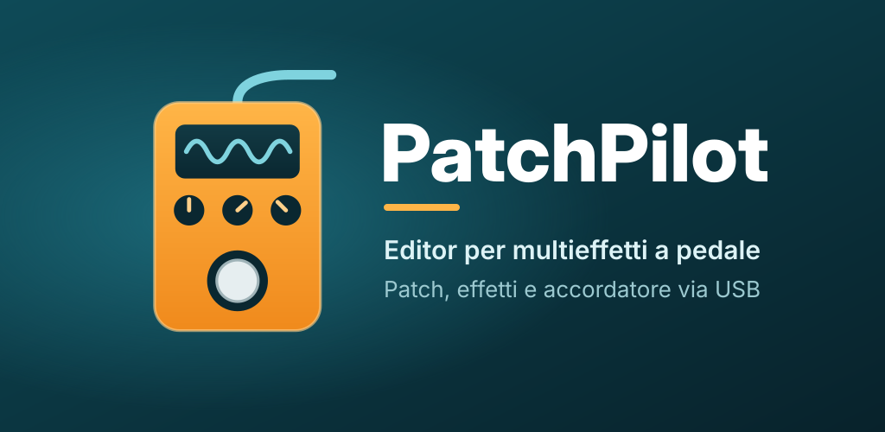

# 🎛️ PatchPilot

### Your multi-effects pedal on Windows, macOS & Linux — and soon on your Android phone
**MS-50G+ · MS-60B+ · MS-70CDR+ · MS-80IR+ · MS-200D+ · MS-90LP+ · G1 FOUR · G1X FOUR · B1 FOUR · B1X FOUR · G2 FOUR · G2X FOUR · B2 FOUR · G6 · G11 · B6** — over a **USB cable**

🌐 **Website:** https://francescorizzo-cyber.github.io/patchpilot/ · *[Italiano più sotto](#italiano)*

PatchPilot connects your **Zoom-compatible multi-effects pedal** to your **Android phone or tablet** with a USB cable
and shows what is inside: **patches, effects, parameters and the tuner**. Zoom has a separate editor app for each pedal, almost all of them for iPhone only:
PatchPilot runs on **Windows, macOS and Linux** computers, and the Android app is coming soon on Google Play.

> 🧪 **This is a beta.** It has been built carefully but **not yet tested on every pedal**.
> 🙋 **Got one of these pedals?** Try it and send us the log from the app: [5-minute test guide](TEST.md#english) ·
> write to **[autofonic.mixer@gmail.com](mailto:autofonic.mixer@gmail.com)** · or **[open an issue](https://github.com/francescorizzo-cyber/patchpilot/issues/new/choose)**.

> ✨ **New in 0.9:** [**all your patches at the same volume**](#-new-in-09), [**songs split into sections that follow the tempo**](#-new-in-09), [**gradual transitions**](#-new-in-09) between sounds, a [**community patch library**](#-new-in-09), six more pedals and the [**Mac version**](#-macos).

## 🎚️ Supported pedals

| Pedal | Model detection | Read patches & patch list | Tuner | Status |
|---|---|---|---|---|
| **MS-50G+** | ✅ | ✅ | ✅ | 🧪 waiting for testers |
| **MS-60B+ · MS-70CDR+ · MS-80IR+ · MS-200D+** | ✅ | ✅ | ✅ | 🧪 waiting for testers |
| **G2 FOUR / G2X FOUR · B2 FOUR** | ✅ | ✅ | ✅ | 🧪 waiting for testers |
| **MS-90LP+** *(new in 0.9)* | ✅ | ✅ | ✅ | 🧪 waiting for testers |
| **G1 FOUR · G1X FOUR · B1 FOUR · B1X FOUR** *(new in 0.9)* | ✅ you choose the model | ✅ on the computer | ⏳ later | 🧪 waiting for testers |
| **G6 · G11 · B6** | ✅ you choose the model | 🧪 not tested on a real pedal | ⏳ later | 🧪 limited support in the beta |
| **Any MIDI pedal, any brand** *(new in 0.9)* | – | – | – | on the computer: sends the patch change for each song of your setlist, plus four MIDI faders |

**16 Zoom pedals** plus a generic MIDI pedal. None of them has been tested by us on a real pedal yet: that is what testers are for.

### 🙋 Your pedal is not in the list? Become a tester

Want PatchPilot to support your pedal, even from another brand? Help us learn how it talks.
The computer program (Windows, macOS, Linux) has a **Tester** page: a guided recording that only **listens**.
It sends your pedal nothing but the standard MIDI identity request, then records what the pedal sends while you
change patch, turn a knob, switch an effect on and off. You save one text file and email it to us.

Send the file to **[autofonic.mixer@gmail.com](mailto:autofonic.mixer@gmail.com)** with brand and model of the pedal.

## 📱 What it does

**One app for 16 pedals**, on Windows, macOS and Linux (Android coming soon) — instead of a separate app for each pedal.

**Look inside your pedal**
- **Connects over USB** and **recognises your pedal** automatically.
- **Patches**: loads the **full list with names** and reads the current patch.
- **Editor view**: each effect slot (on/off) with its parameters; import your **.ZD2** effect files to see effect and parameter names.
- **Tuner**: note and cents on the screen.

**Keep your sounds safe and organised** *(new in 0.8)*
- **Backup**: save all the patches of your pedal to a file, and load them back into the app whenever you want.
- **Sound sheets**: a readable card for every patch (effects, on/off, parameters) to print, save or share.
- **Search**: "where did I use that delay?" — find the patches that use an effect.
- **Compare**: two patches side by side, showing only what is different.

**On stage** *(new in 0.8)*
- **Setlist**: put your songs in order and choose the patch for each one — **one patch per pedal** if you use more than one pedal.
- **Stage mode**: a dark full-screen view with big text: the song, the patch to select on each pedal, and what comes next.

**And also**
- **Log + Share**: every MIDI message explained, sent to us with one tap when something does not work.
- **Demo mode and sample data**: try everything without a pedal.

*Coming after the tests on real pedals: changing patch from the app (also on several pedals at once) and editing parameters.*

## 🧭 All features

Everything PatchPilot does today, in the version you download. Nothing is ever written to the pedal.

**Look inside your pedal**

- 🔌 **Detects the pedal by itself**: Plug in the USB cable and PatchPilot tells you the model and firmware version. For models that do not identify themselves you pick it from a list.
- 📋 **Full patch list**: Every patch on the pedal with its name, at a glance, with the selected one highlighted.
- 🎛️ **Effects and parameters editor**: Every slot with its effect, on or off, and all its parameters. **Knob** or **fader** view: turn them to try things out — it all stays in the program.
- 🏷️ **Real effect and parameter names**: Import your own `.ZD2` files and see effect and knob names instead of numbers.
- 🎸 **Needle tuner**: The pedal's tuner, big on the screen, with note and cents: readable from across the room.
- 🖼️ **A pedal-shaped screen**: The main page draws your model: display, knobs and switches are clickable.

**Keep your sounds safe**

- 💾 **Backup of every patch**: Save all the pedal's patches to a file and reopen them any time, even with no pedal connected.
- 📄 **Sound sheets**: A readable sheet for each patch — effects, on/off, parameters — to print, save or share.
- 🔎 **Search by effect**: “Where did I use that delay?” Find every patch that uses an effect.
- ⚖️ **Compare two patches**: Put two patches side by side and see only the differences.

**On stage**

- 🎶 **Setlist**: Order your songs and pick the patch for each, one per pedal if you use several. With capo and notes.
- ⏭️ **Song bar**: Change song with the mouse wheel, arrow keys, space bar or a USB page-turner pedal, and search a song by name.
- 🌙 **Stage mode**: A dark screen with big letters: which patch to select now and what comes next.
- 🥁 **Songs that follow the tempo**: Split a song into sections with their bars: count-in, beats on screen and a **“GET READY”** warning before every change. Also shows delay times.
- 🌊 **Gradual transitions**: The sound changes little by little, like a virtual expression pedal, over the seconds or bars you choose.

**Volume and levels**

- 🔊 **Every patch at the same volume**: Play the same riff with each patch: PatchPilot measures loudness as the ear hears it (LUFS) and tells you the patch level to set.
- 📈 **Audio level meter**: If your pedal is also a USB audio interface, see the signal level. Sound is only measured, never recorded.
- 🎚️ **MIDI faders**: Four sliders sending standard Control Change (volume, expression…) to a generic MIDI pedal.

**Other pedals and community**

- 🎹 **Any MIDI pedal**: With a pedal of another brand the computer sends the patch change for every song in the setlist.
- 📚 **Community patch library**: Patches shared by PatchPilot users, free for everyone (CC0), searchable by song, artist, genre and pedal.
- 🙋 **Tester page**: Your pedal is not listed? A guided, listen-only recording helps us add it.
- 🧾 **Log**: Everything the program and the pedal say to each other, to save and send if something goes wrong.

**Free and full version**: Today, with 0.9, everything is free. From 0.9.1 it works like this: 7 days with everything on, then what you need to see whether your pedal works stays free forever.

| Feature | Free forever | Full version |
|---|:---:|:---:|
| Pedal detection, patch list, editor | ✅ | ✅ |
| Tuner, log, Tester page | ✅ | ✅ |
| Setlist up to 3 songs | ✅ | ✅ |
| Community patch library | ✅ | ✅ |
| Unlimited setlist and stage mode | — | ✅ |
| Backup to file and sound sheets | — | ✅ |
| Search by effect and compare | — | ✅ |
| Saved variants (0.9.1) | — | ✅ |
| AI assistant and teacher (0.9.1) | 7-day trial | 100 requests a month |

## ✨ New in 0.9

Features you will not find in other pedal editors, a library shared by everyone, and the Mac version. They are in the download now; like the rest of the beta, they still wait for tests on real pedals.

**🔊 All your patches at the same volume**
No more jumps when you switch patch live: the clean one too quiet, the lead one too loud.
Play the same riff with each patch for 6 seconds: PatchPilot measures how loud it **sounds to the ear**
(LUFS, the broadcast loudness standard, with pauses ignored) and tells you the patch level that makes every patch even.
Measure again after setting the levels, to check the result.
*Windows, macOS and Linux. Your pedal's output goes into the computer: through the pedal itself if it works as a USB audio interface, or through an audio interface.
The sound is only measured: it is never recorded or saved, and nothing is written to the pedal.*

**🥁 Songs that follow the tempo**
Give each song its tempo and split it into **sections**: intro, verse, chorus, solo… each one with its length in bars and its patch.
In stage mode press **T**: one bar of count-in, then PatchPilot shows the beats, moves to the next section on its own
when the bars are over, and in the last bar warns you **"GET READY: 1-03 Crunch"** before every patch change.
A press of the button or of a **Bluetooth page-turner pedal** puts you back in time whenever you need it.
It also shows the **delay times** for the song's tempo (1/4, dotted 1/8, 1/8).
*Android, Windows, macOS and Linux. With a generic MIDI pedal the computer sends the patch of each section by itself.*

**🌊 Gradual transitions**
Instead of jumping from one sound to the next, the sound changes **little by little**, like a **virtual expression pedal**:
from one value to another in the seconds you choose, or over a few bars for each section of the setlist.
On Zoom pedals you can already preview the values halfway between two patches.
*Windows, macOS and Linux, sent to a generic MIDI pedal (expression CC). On Zoom pedals sending will come after the tests on real pedals.*

**📚 Community patch library**
A **public repository of patches** made by PatchPilot users, free for everyone (CC0), searchable by **song, artist, genre and pedal**.
In PatchPilot, *Patch* page → **Share in the library**: one click opens the GitHub form already filled in (or an email, if you have no GitHub account),
an automatic check verifies the patch within a minute and, once approved, it appears in the [library page](https://francescorizzo-cyber.github.io/patchpilot/libreria/)
and in the repository folder [`docs/libreria/patch`](docs/libreria/patch). Download a patch and open it with *Import*: you get its sound sheet.
*Only the patch is shared (which effects, with which values), never Zoom's effect files. Sending a library patch straight to the pedal will come after the tests on real pedals.*

**🎚️ Also new** — a main screen shaped like your pedal, with the **song bar** (mouse wheel, arrow keys or a USB page-turner pedal change song; search by name), a **needle tuner**, a **fader view** in the editor, **MIDI faders** and an **audio level meter**.

**🍎 PatchPilot for Mac** — see [macOS](#-macos) below.

## 🤖 Coming in 0.9.1: AI assistant, teacher and variants

Ready and being tested: they arrive with the next update, on Windows, macOS and Linux. They are not in today's download yet.

**🤖 Describe the sound**: Type what you want to hear — *“warmer, with less reverb”* — and the AI assistant suggests which knobs to turn and why, using the effects already in your patch. *The suggestion stays in the editor: nothing is written to the pedal. Needs internet; only your description and the patch values go to the service, never audio.*

**🎓 The teacher**: One click on **“Explain this patch”** and PatchPilot tells you, in plain words, what every effect and every knob does, how they work together, and a small experiment to try. *Made for beginners and for anyone who downloaded a patch and wants to understand it.*

**💾 Save a variant**: Keep several versions of the same patch — *“clean verse”*, *“solo with more gain”* — and recall them from the editor. *Variants are files on your computer: the pedal's memory is not touched.*

**🎛️ Other brands too**: Besides the 16 Zoom pedals, ready-made profiles for **Line 6 HX Stomp** and **Valeton GP-200**: patch change from the setlist and MIDI controls with their own names. *Over standard MIDI. Not yet tried on real pedals: testers wanted.*

**⏳ 7 days with everything on**: From 0.9.1 PatchPilot works in full for 7 days, AI assistant included (5 trial requests). After that, pedal detection, patch reading, tuner and a 3-song setlist **stay free forever**. *The rest, with 100 AI requests a month, is in the full version: €4.99, paid once.*

## 🛡️ Your pedal is safe

The beta **only reads**. It **never writes, saves or deletes** anything in your pedal's memory: those commands are blocked in the code.
Backups, sound sheets and the setlist are files on your phone or computer: nothing is written to the pedal.
Read requests are sent only after you switch on **reading from the pedal** (Connect screen).

## ⬇️ Install

### 📱 Android: coming soon on Google Play

The Android app will be installed **only from Google Play**. It is not available yet: the link will appear here.
It will need **Android 8.0 or later** with **USB host (OTG)** and a **USB-C / OTG cable** for the pedal.

### 🍎 macOS

From [Releases](../../releases/latest): `PatchPilot-x.y.z-macos-arm64.dmg` for **Apple Silicon** Macs (M1, M2, M3, M4) or `…-macos-x64.dmg` for **Intel** Macs, with Java included. Open the `.dmg` and drag PatchPilot into Applications.
PatchPilot is not signed with a paid Apple certificate: the first time, macOS says it cannot check the developer.
Open **System Settings → Privacy & Security → Open Anyway** (on older Macs: right-click PatchPilot → Open). Not tested on a real Mac yet: **Mac testers wanted**.

### 💻 Windows and Linux

- **Windows 10/11**: `PatchPilot-x.y.z-windows-x64-setup.exe` (installer) or `…-portatile.zip` (portable, no install). If SmartScreen warns you, click **More info → Run anyway**.
- **Linux**: `PatchPilot-x.y.z-linux-x64.deb` (Ubuntu/Debian: `sudo apt install ./PatchPilot-….deb`) or `…-linux-x64.tar.gz` (unpack and run `PatchPilot/bin/PatchPilot`).
- Java is included. Connect the pedal with its USB cable, then **Collega → Cerca dispositivi → Collega e identifica**. Close Guitar Lab first: the pedal's MIDI port works with one program at a time.

> ℹ️ If you installed an earlier APK from this page: when PatchPilot arrives on **Google Play**, uninstall it first. The two versions are signed differently.

## 🔑 Full version: €4.99, one time only

**Today every feature is free**, because PatchPilot is in beta. Later, exporting backups to a file, sound sheets, search, compare,
the setlist beyond 3 songs and stage mode will be part of the **full version: €4.99, paid once**, valid forever on that phone or computer.
Model detection, patch list, editor view, tuner and a 3-song setlist stay free.
If you buy now you support the project and you already have your code when the full version is switched on.

1. Open PatchPilot on your computer and go to the *Sostieni ♥* page. Your device code looks like `PP-ABCD-EFGH`.
2. Pay **€4.99**, either way:
   - **[💳 Card, Google Pay or Apple Pay (Stripe)](https://buy.stripe.com/00w6oG96j0DqcBG5DX63K01)**: type your device code when asked and the **unlock code appears right after the payment**.
   - **[🅿️ PayPal](https://paypal.me/AutoFonicMixer/4.99EUR)**: then send the email to **[autofonic.mixer@gmail.com](mailto:autofonic.mixer@gmail.com)** and you receive your **unlock code** by email, usually within a day.

One code per computer (Windows, macOS and Linux). On Android (coming soon on Google Play) the full version will be bought inside the app, with Google Play.
Just want to say thanks? Any amount is welcome: **[paypal.me/AutoFonicMixer](https://paypal.me/AutoFonicMixer)**.

## 🛒 On Google Play

Coming soon. The Android app will be available only from Google Play; the link will appear here.

## 📄 Privacy & license

No account, no ads, no data collected, no internet access: [privacy policy](PRIVACY.md). Free to use: [license](LICENSE).

PatchPilot is an independent project, **not affiliated with, endorsed or sponsored by Zoom Corporation**.
Zoom, MultiStomp and Handy Guitar Lab are trademarks of their respective owners, mentioned only to describe compatibility.

---

# 🇮🇹 Italiano

PatchPilot collega il tuo **multieffetto a pedale compatibile Zoom** al **telefono o tablet Android** con un cavo USB
e ti mostra cosa contiene: **patch, effetti, parametri e accordatore**. Zoom ha un'app diversa per ogni pedale, quasi tutte solo per iPhone:
PatchPilot funziona sui computer **Windows, macOS e Linux**, e l'app Android è in arrivo su Google Play.

🌐 **Sito:** https://francescorizzo-cyber.github.io/patchpilot/it/ · 🔑 **[Versione completa: 4,99 €](#versione-completa)**

> 🧪 **È una beta.** È stata costruita con cura ma **non è ancora stata provata su tutti i pedali**.
> 🙋 **Hai uno di questi pedali?** Provala e mandaci il registro dall'app: [guida di prova in 5 minuti](TEST.md#italiano) ·
> scrivi a **[autofonic.mixer@gmail.com](mailto:autofonic.mixer@gmail.com)** · oppure **[apri una segnalazione](https://github.com/francescorizzo-cyber/patchpilot/issues/new/choose)**.

> ✨ **Novità della 0.9:** [**tutte le patch allo stesso volume**](#-novità-della-09), [**brani divisi in sezioni che seguono il tempo**](#-novità-della-09), [**passaggi graduali**](#-novità-della-09) da un suono all'altro, la [**libreria di patch della comunità**](#-novità-della-09), sei pedali in più e la [**versione per Mac**](#-mac).

## 🎚️ Pedali supportati

| Pedale | Riconoscimento | Lettura patch ed elenco | Accordatore | Stato |
|---|---|---|---|---|
| **MS-50G+** | ✅ | ✅ | ✅ | 🧪 aspetta i tester |
| **MS-60B+ · MS-70CDR+ · MS-80IR+ · MS-200D+** | ✅ | ✅ | ✅ | 🧪 aspetta i tester |
| **G2 FOUR / G2X FOUR · B2 FOUR** | ✅ | ✅ | ✅ | 🧪 aspetta i tester |
| **MS-90LP+** *(novità 0.9)* | ✅ | ✅ | ✅ | 🧪 aspetta i tester |
| **G1 FOUR · G1X FOUR · B1 FOUR · B1X FOUR** *(novità 0.9)* | ✅ modello scelto da te | ✅ sul computer | ⏳ più avanti | 🧪 aspetta i tester |
| **G6 · G11 · B6** | ✅ modello scelto da te | 🧪 non provata su un pedale vero | ⏳ più avanti | 🧪 supporto limitato nella beta |
| **Qualsiasi pedale MIDI, di qualsiasi marca** *(novità 0.9)* | – | – | – | sul computer: manda il cambio patch per ogni brano della scaletta, più quattro fader MIDI |

**16 pedali Zoom** più un pedale MIDI generico. Nessuno è ancora stato provato da noi su un pedale vero: per questo cerchiamo tester.

### 🙋 Il tuo pedale non è in elenco? Diventa tester

Vuoi che PatchPilot supporti il tuo pedale, anche di un'altra marca? Aiutaci a capire come parla.
Il programma per computer (Windows, macOS, Linux) ha la pagina **Tester**: una registrazione guidata che **ascolta soltanto**.
Al pedale manda solo la richiesta di identità MIDI standard, poi registra quello che il pedale invia mentre
cambi patch, giri una manopola, spegni e riaccendi un effetto. Alla fine salvi un file di testo e ce lo mandi per email.

Manda il file a **[autofonic.mixer@gmail.com](mailto:autofonic.mixer@gmail.com)** con marca e modello del pedale.

## 📱 Cosa fa

**Una sola app per 16 pedali**, su Windows, macOS e Linux (Android in arrivo), al posto di un'app diversa per ogni pedale.

**Guarda dentro il pedale**
- **Si collega via USB** e **riconosce il pedale** da solo.
- **Patch**: carica **l'elenco completo con i nomi** e legge la patch corrente.
- **Editor**: ogni slot (acceso/spento) con i suoi parametri; importa i tuoi file **.ZD2** per vedere i nomi di effetti e parametri.
- **Accordatore**: nota e cents sullo schermo.

**Tieni i tuoi suoni al sicuro e in ordine** *(novità 0.8)*
- **Backup**: salva su file tutte le patch del pedale e ricaricale nell'app quando vuoi.
- **Schede suono**: una scheda leggibile per ogni patch (effetti, acceso/spento, parametri) da stampare, salvare o condividere.
- **Cerca**: "dove ho usato quel delay?" — trova le patch che usano un effetto.
- **Confronta**: due patch a confronto, mostrando solo le differenze.

**Sul palco** *(novità 0.8)*
- **Scaletta**: metti in ordine i brani e scegli la patch per ognuno — **una patch per pedale** se ne usi più di uno.
- **Modalità palco**: schermo scuro a caratteri grandi con il brano, la patch da selezionare su ogni pedale e il brano successivo.

**E inoltre**
- **Registro + Condividi**: ogni messaggio MIDI spiegato, e con un tocco ce lo mandi se qualcosa non va.
- **Modalità demo e dati di esempio**: per provare tutto senza pedale.

*In arrivo dopo le prove sui pedali reali: cambio patch dall'app (anche su più pedali insieme) e modifica dei parametri.*

## 🧭 Tutte le funzioni

Tutto quello che PatchPilot fa oggi, nella versione che scarichi. Sul pedale non viene mai scritto niente.

**Guarda dentro il pedale**

- 🔌 **Riconosce il pedale da solo**: Colleghi il cavo USB e PatchPilot ti dice che modello è e che versione ha. Per i modelli che non si presentano da soli lo scegli tu da un elenco.
- 📋 **Elenco di tutte le patch**: Tutte le patch del pedale con il loro nome, in un colpo d'occhio, e quella selezionata in evidenza.
- 🎛️ **Editor di effetti e parametri**: Ogni slot con il suo effetto, acceso o spento, e tutti i parametri. Vista a **manopole** o a **fader**: puoi girarle per provare, ma resta tutto nel programma.
- 🏷️ **Nomi veri di effetti e parametri**: Importa i tuoi file `.ZD2` e al posto dei numeri vedi i nomi degli effetti e delle manopole.
- 🎸 **Accordatore a lancetta**: L'accordatore del pedale, grande sullo schermo, con la nota e i cent: lo leggi anche da lontano.
- 🖼️ **Schermata a forma di pedale**: La pagina principale disegna il tuo modello: display, manopole e interruttori si possono cliccare.

**Metti al sicuro i tuoi suoni**

- 💾 **Backup di tutte le patch**: Salva in un file tutte le patch del pedale e riaprile quando vuoi, anche senza il pedale collegato.
- 📄 **Schede suono**: Per ogni patch una scheda leggibile — effetti, acceso/spento, parametri — da stampare, salvare o condividere.
- 🔎 **Ricerca per effetto**: «Dove ho usato quel delay?» Trovi subito tutte le patch che usano un effetto.
- ⚖️ **Confronto tra due patch**: Metti due patch una accanto all'altra e vedi solo le differenze.

**Sul palco**

- 🎶 **Scaletta**: Metti in ordine i brani e scegli la patch per ognuno, una per pedale se ne usi più di uno. Con capotasto e note.
- ⏭️ **Barra dei brani**: Cambi brano con la rotella del mouse, le frecce, la barra spaziatrice o un pedale USB volta-pagina, e cerchi un brano per nome.
- 🌙 **Modalità palco**: Schermo scuro a caratteri grandi: quale patch selezionare adesso e cosa viene dopo.
- 🥁 **Brani che seguono il tempo**: Dividi il brano in sezioni con le loro battute: conteggio iniziale, battiti sullo schermo e l'avviso **«PREPARA»** prima di ogni cambio. Mostra anche i tempi del delay.
- 🌊 **Passaggi graduali**: Il suono cambia piano piano, come con un pedale d'espressione virtuale, nei secondi o nelle battute che scegli.

**Volume e livelli**

- 🔊 **Tutte le patch allo stesso volume**: Suoni lo stesso giro con ogni patch: PatchPilot misura il volume come lo sente l'orecchio (LUFS) e ti dice che volume patch impostare.
- 📈 **Misuratore del livello audio**: Se il pedale fa anche da scheda audio, vedi il livello del segnale. Il suono viene solo misurato, mai registrato.
- 🎚️ **Fader MIDI**: Quattro cursori che mandano Control Change standard (volume, espressione…) a un pedale MIDI generico.

**Altri pedali e comunità**

- 🎹 **Qualsiasi pedale MIDI**: Con un pedale di un'altra marca il computer manda da solo il cambio patch per ogni brano della scaletta.
- 📚 **Libreria di patch della comunità**: Patch condivise da chi usa PatchPilot, libere per tutti (CC0), da cercare per brano, artista, genere e pedale.
- 🙋 **Pagina Tester**: Il tuo pedale non è in elenco? Una registrazione guidata che ascolta soltanto ci aiuta ad aggiungerlo.
- 🧾 **Registro**: Tutto quello che il programma e il pedale si dicono, da salvare e mandare se qualcosa non va.

**Gratis e versione completa**: Oggi, con la 0.9, è tutto gratuito. Dalla 0.9.1 funziona così: 7 giorni con tutto acceso, poi resta gratis per sempre quello che serve per vedere se il tuo pedale funziona.

| Funzione | Gratis per sempre | Versione completa |
|---|:---:|:---:|
| Riconoscimento del pedale, elenco patch, editor | ✅ | ✅ |
| Accordatore, registro, pagina Tester | ✅ | ✅ |
| Scaletta fino a 3 brani | ✅ | ✅ |
| Libreria di patch della comunità | ✅ | ✅ |
| Scaletta senza limiti e modalità palco | — | ✅ |
| Backup su file e schede suono | — | ✅ |
| Ricerca per effetto e confronto | — | ✅ |
| Varianti salvate (0.9.1) | — | ✅ |
| Assistente AI e maestro (0.9.1) | 7 giorni di prova | 100 richieste al mese |

## ✨ Novità della 0.9

Funzioni che negli altri editor per pedali non trovi, una libreria condivisa da tutti e la versione per Mac. Sono già nel download; come il resto della beta, aspettano ancora le prove sui pedali veri.

**🔊 Tutte le patch allo stesso volume**
Basta salti quando cambi patch dal vivo, con la pulita troppo bassa e quella da assolo troppo forte.
Suoni lo stesso giro con ogni patch per 6 secondi: PatchPilot misura quanto è forte **come la sente l'orecchio**
(LUFS, lo standard della radio e della TV, senza contare le pause) e ti dice il volume patch che le rende tutte uguali.
Dopo aver impostato i volumi rimisuri e controlli il risultato.
*Windows, macOS e Linux. L'uscita del pedale entra nel computer: dal pedale stesso se fa da scheda audio USB, oppure da una scheda audio.
Il suono viene solo misurato: non viene mai registrato né salvato, e sul pedale non si scrive niente.*

**🥁 Brani che seguono il tempo**
Dai a ogni brano il suo tempo e dividilo in **sezioni**: intro, strofa, ritornello, assolo… ognuna con le sue battute e la sua patch.
In modalità palco premi **T**: una battuta di conteggio, poi PatchPilot mostra i battiti, passa da solo alla sezione dopo
quando finiscono le battute e nell'ultima battuta ti avvisa **«PREPARA: 1-03 Crunch»** prima di ogni cambio di patch.
Un tocco sul pulsante o su un **pedale Bluetooth volta pagina** ti rimette a tempo quando serve.
Mostra anche i **tempi del delay** per il tempo del brano (1/4, 1/8 puntato, 1/8).
*Android, Windows, macOS e Linux. Con un pedale MIDI generico il computer manda da solo la patch di ogni sezione.*

**🌊 Passaggi graduali**
Invece di saltare da un suono all'altro, il suono cambia **piano piano**, come con un **pedale d'espressione virtuale**:
da un valore a un altro nei secondi che scegli, oppure in qualche battuta per ogni sezione della scaletta.
Sui pedali Zoom puoi già vedere in anteprima i valori a metà strada tra due patch.
*Windows, macOS e Linux, verso un pedale MIDI generico (CC di espressione). Sui pedali Zoom l'invio arriverà dopo le prove sui pedali reali.*

**📚 Libreria di patch della comunità**
Un **repository pubblico di patch** fatte da chi usa PatchPilot, libere per tutti (CC0), da cercare per **brano, artista, genere e pedale**.
In PatchPilot, pagina *Patch* → **Condividi nella libreria**: un clic apre il modulo su GitHub già compilato (oppure un'email, se non hai un account GitHub),
un controllo automatico verifica la patch in un minuto e, appena approvata, compare nella [pagina della libreria](https://francescorizzo-cyber.github.io/patchpilot/it/libreria/)
e nella cartella del repository [`docs/libreria/patch`](docs/libreria/patch). Scarica una patch e aprila con *Importa*: vedi la sua scheda suono.
*Si condivide solo la patch (quali effetti e con quali valori), mai i file degli effetti Zoom. L'invio di una patch della libreria direttamente al pedale arriverà dopo le prove sui pedali reali.*

**🎚️ E ancora**: schermata principale a forma di pedale, con la **barra dei brani** (rotella del mouse, frecce o un pedale USB volta-pagina cambiano brano; ricerca per nome), **accordatore a lancetta**, **vista a fader** nell'editor, **fader MIDI** e **misuratore del livello audio**.

**🍎 PatchPilot per Mac**: vedi [Mac](#-mac) più sotto.

## 🤖 In arrivo con la 0.9.1: assistente AI, maestro e varianti

Già pronte e in prova: arrivano con il prossimo aggiornamento, su Windows, macOS e Linux. Non sono ancora nel download di oggi.

**🤖 Descrivi il suono**: Scrivi quello che vuoi sentire — *«più caldo e con meno riverbero»* — e l'assistente AI ti propone quali manopole toccare e perché, usando gli effetti che hai già nella patch. *La proposta resta nell'editor: sul pedale non viene scritto niente. Serve internet; al servizio vanno solo la descrizione e i valori della patch, mai l'audio.*

**🎓 Il maestro**: Un clic su **«Spiegami questa patch»** e PatchPilot ti dice, in parole semplici, a cosa serve ogni effetto e ogni manopola, come lavorano insieme e un piccolo esperimento da provare. *Pensato per chi comincia e per chi ha scaricato una patch e vuole capirla.*

**💾 Salva variante**: Tieni più versioni della stessa patch — *«strofa pulita»*, *«assolo con più gain»* — e richiamale dall'editor. *Le varianti sono file sul tuo computer: la memoria del pedale non viene toccata.*

**🎛️ Anche altre marche**: Oltre ai 16 Zoom, profili pronti per **Line 6 HX Stomp** e **Valeton GP-200**: cambio patch dalla scaletta e comandi MIDI con i loro nomi. *Via MIDI standard. Non ancora provati sui pedali veri: cerchiamo tester.*

**⏳ 7 giorni con tutto acceso**: Dalla 0.9.1 PatchPilot funziona per intero per 7 giorni, assistente AI compreso (5 richieste di prova). Poi riconoscimento del pedale, lettura delle patch, accordatore e scaletta di 3 brani **restano gratis per sempre**. *Il resto, con 100 richieste al mese all'assistente AI, è nella versione completa: 4,99 €, una volta sola.*

## 🛡️ Il tuo pedale è al sicuro

La beta **legge soltanto**. **Non scrive, non salva e non cancella** nulla nella memoria del pedale: quei comandi sono bloccati nel codice.
Backup, schede suono e scaletta sono file sul tuo telefono o computer: sul pedale non viene scritto niente.
Le richieste di lettura partono solo dopo aver attivato la **lettura dal pedale** (schermata Collega).

## ⬇️ Installazione

### 📱 Android: in arrivo su Google Play

L'app Android si installerà **solo da Google Play**. Non è ancora disponibile: il link comparirà qui.
Servirà **Android 8.0 o successivo** con **USB host (OTG)** e un cavo **USB-C / OTG** per il pedale.

### 🍎 Mac

Da [Releases](../../releases/latest): `PatchPilot-x.y.z-macos-arm64.dmg` per i Mac **Apple Silicon** (M1, M2, M3, M4) oppure `…-macos-x64.dmg` per i Mac **Intel**, con Java incluso. Apri il `.dmg` e trascina PatchPilot in Applicazioni.
PatchPilot non è firmato con un certificato Apple a pagamento: la prima volta il Mac dice che non può verificare lo sviluppatore.
Apri **Impostazioni di Sistema → Privacy e sicurezza → Apri comunque** (sui Mac più vecchi: tasto destro su PatchPilot → Apri). Non ancora provato su un Mac vero: **cerchiamo tester con il Mac**.

### 💻 Windows e Linux

- **Windows 10/11**: `PatchPilot-x.y.z-windows-x64-setup.exe` (installatore) oppure `…-portatile.zip` (senza installazione). Se SmartScreen avvisa, clicca **Ulteriori informazioni → Esegui comunque**.
- **Linux**: `PatchPilot-x.y.z-linux-x64.deb` (Ubuntu/Debian: `sudo apt install ./PatchPilot-….deb`) oppure `…-linux-x64.tar.gz` (scompatta e avvia `PatchPilot/bin/PatchPilot`).
- Java è incluso. Collega il pedale con il suo cavo USB, poi **Collega → Cerca dispositivi → Collega e identifica**. Chiudi prima Guitar Lab: la porta MIDI del pedale funziona con un programma alla volta.

> ℹ️ Se avevi installato un APK scaricato da questa pagina: quando PatchPilot arriverà su **Google Play**, disinstallalo prima. Le due versioni sono firmate in modo diverso.

## 🔑 Versione completa: 4,99 €, una volta sola

**Oggi tutte le funzioni sono gratuite**, perché PatchPilot è in beta. Più avanti l'esportazione dei backup su file, le schede suono,
la ricerca, il confronto, la scaletta oltre i 3 brani e la modalità palco faranno parte della **versione completa: 4,99 €, una volta sola**,
valida per sempre su quel telefono o computer. Riconoscimento del pedale, elenco patch, editor, accordatore e scaletta di 3 brani restano gratuiti.
Se la compri adesso sostieni il progetto e hai già il tuo codice quando la versione completa verrà attivata.

1. Apri PatchPilot sul computer e vai alla pagina *Sostieni ♥*. Il codice dispositivo ha la forma `PP-ABCD-EFGH`.
2. Paga **4,99 €**, come preferisci:
   - **[💳 Carta, Google Pay o Apple Pay (Stripe)](https://buy.stripe.com/00w6oG96j0DqcBG5DX63K01)**: scrivi il codice dispositivo quando viene chiesto e il **codice di sblocco appare subito dopo il pagamento**.
   - **[🅿️ PayPal](https://paypal.me/AutoFonicMixer/4.99EUR)**: poi invia l'email ad **[autofonic.mixer@gmail.com](mailto:autofonic.mixer@gmail.com)** e ricevi il **codice di sblocco** per email, di solito entro un giorno.

Un codice per ogni computer (Windows, macOS e Linux). Su Android (in arrivo su Google Play) la versione completa si comprerà dentro l'app, con Google Play.
Vuoi solo dire grazie? Qualsiasi offerta è benvenuta: **[paypal.me/AutoFonicMixer](https://paypal.me/AutoFonicMixer)**.

## 📄 Privacy e licenza

Nessun account, nessuna pubblicità, nessun dato raccolto, nessun accesso a Internet: [informativa privacy](PRIVACY.md). Uso gratuito: [licenza](LICENSE).

PatchPilot è un progetto indipendente, **non affiliato, approvato o sponsorizzato da Zoom Corporation**.
Zoom, MultiStomp e Handy Guitar Lab sono marchi dei rispettivi proprietari, citati solo per indicare la compatibilità.

Contatti: **[autofonic.mixer@gmail.com](mailto:autofonic.mixer@gmail.com)**
